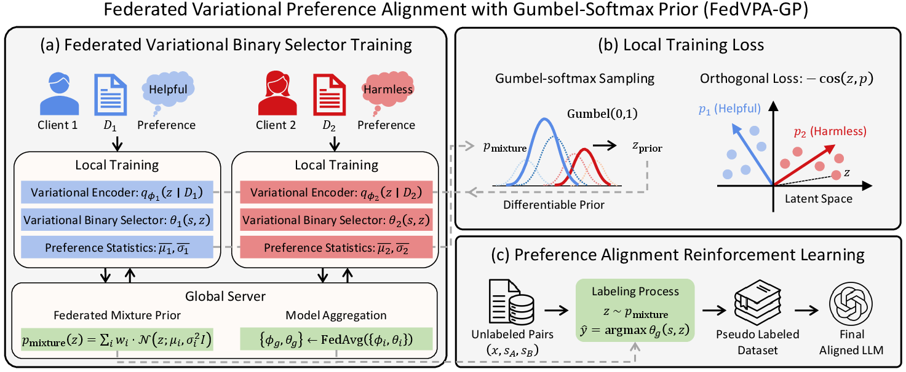
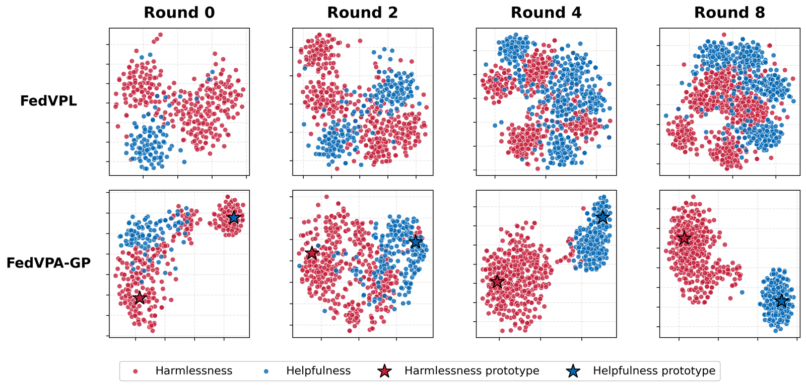

# FedVPA-GP

Reference implementation of **Federated Variational Preference Alignment with Gumbel-Softmax Prior for Personalized User Preferences** (ICML 2026).

Jabin Koo, Hoyoung Kim, Minwoo Jang, Jungseul Ok — POSTECH, National AI Research Lab.



Federated alignment methods train one monolithic reward model, averaging away conflicting user preferences. Variational preference learning (VPL) is the natural fix, but in federated settings the posterior `q(z|D_i)` collapses toward the prior because local data is scarce and heterogeneous. FedVPA-GP prevents that with two mechanisms:

- **Federated mixture prior** — the server replaces `N(0, I)` with `p_mixture(z) = Σ_j w_j · N(z; μ_j, σ_j²)` built from peer posteriors, weighted by a learnable Gumbel-Softmax relaxation.
- **Orthogonal loss** — `M` learnable prototypes, initialized as an orthonormal basis, anchor the latent space. A pull term binds each client's `z` to its prototype; a Frobenius constraint `‖PPᵀ − I‖²_F` keeps prototypes apart.

## Results

GPT win-rate (%) on HH-RLHF, strict non-IID partition, Qwen2-0.5B. Published Table 1 numbers; judge is `gpt-4o-mini`.

| Method | K=10 Helpful | K=10 Harmless | K=100 Helpful | K=100 Harmless |
|---|---|---|---|---|
| FedDPO | 48.12 ± 1.52 | 77.34 ± 2.41 | 41.48 ± 2.32 | 67.15 ± 2.64 |
| FedBiscuit | 48.85 ± 1.41 | 75.12 ± 2.28 | 42.33 ± 2.11 | 69.42 ± 2.45 |
| FedVPL | 62.24 ± 1.25 | 84.56 ± 1.95 | 53.05 ± 1.88 | 77.34 ± 2.21 |
| **FedVPA-GP** | **66.45 ± 1.12** | **89.21 ± 1.68** | **55.18 ± 1.55** | **82.31 ± 2.05** |

Only the FedVPA-GP row is reproducible here; baselines are shown for context.



FedVPL's latents stay entangled; FedVPA-GP separates helpfulness from harmlessness around the two prototypes within a few rounds.

## Setup

Python 3.10, one CUDA GPU with ≥16 GB (peak usage is ~13 GB).

```bash
conda create -n fedvpagp python=3.10 -y && conda activate fedvpagp
pip install torch==2.2.0 torchvision==0.17.0 torchaudio==2.2.0 \
    --index-url https://download.pytorch.org/whl/cu121
pip install -r requirements.txt
pip install -e . --no-deps
```

`--no-deps` is required: `setup.py` carries upstream FederatedScope ranges that upgrade numpy past what scikit-learn 1.0.2 accepts. Three pins are load-bearing — `numpy<1.23` (sklearn ABI; k-means assigns the prototype labels), `protobuf==3.20.x` (grpc message contract), and `transformers==4.51.3` with `peft==0.15.2` (the `inputs_embeds` path used by z-conditioning).

HH-RLHF and Qwen2-0.5B download from the Hugging Face Hub on first run.

## Running

```bash
bash scripts/run_selector.sh 10 0     # Stage 1: federated selector, K=10, GPU 0
bash scripts/run_rl.sh       10 0     # Stage 2: z-conditioned DPO
```

Arguments are client count (`10` or `100`) and GPU index. `DATA_ROOT`, `CKPT_DIR`, and `LOG_DIR` override paths.

| | K=10 | K=100 |
|---|---|---|
| Stage 1, 50 rounds | 4h15m (measured) | ~7 h |
| Stage 2, 50 rounds | ~10 h | ~15 h |

**OpenAI key.** Needed only for win-rate evaluation in Stage 2 — one call site, `llm/metric/winrate_metrics.py`. Stage 1 never contacts the API and Stage 2 trains fine without a key; you just get no win-rate. To enable it, `cp .env.example .env` and set `OPENAI_API_KEY`.

See [docs/REPRODUCE.md](docs/REPRODUCE.md) for what to watch in the logs and troubleshooting.

## Configuration

Table 4 (Appendix B) of the paper. Values shown are the Qwen2-0.5B choice where the paper gives a model-dependent range.

| Parameter | Stage 1 | Stage 2 |
|---|---|---|
| Learning rate | 1e-5 | 1e-5 |
| Batch size / grad accum | 4 / 8 | 1 / 32 |
| Local update steps | 30 | 30 |
| Total rounds | 50 | 50 |
| KL weight β | 0.01 | — |
| Orthogonal weight λ | 1.0 | — |
| Orthonorm weight γ | 0.1 | — |
| Gumbel-Softmax τ | 1.0 | — |
| Latent dim d | 32 | — |
| Latent projection | MLP 32→64→32→\|C\| | — |
| Prototypes M / scale | 2 / 5.0 | — |
| Label assignment | balanced k-means | — |
| Max log-variance | −4.0 | — |
| LoRA r / α / dropout | 8 / 16 / 0.05 | 8 / 16 / 0.05 |
| Reward coefficient | — | 0.1 |

Three things fail silently rather than erroring:

1. **The z-conditioning block must match across stages.** Stage 1 needs `vpl_use_z_embedding`, `vpl_z_source`, `vpl_z_conditioning_mode`, and `vpl_adapter_dropout` so it saves a `z_to_embedding`. Missing from the checkpoint, Stage 2 initializes one randomly and the policy collapses to a single preference.
2. **Reward coefficient and learning rate interact at scale.** At K=100, `reward_coeff: 0.5` with `lr: 5e-5` diverges — loss in the thousands against a normal ~1.
3. **The win-rate peak is not the final round.** It lands mid-training, which is why Stage 2 checkpoints every 10 rounds. Report the Pareto-best round, not round 50.

One deviation from the paper: `max_samples_for_reward` is 100, not the stated 30. At n=30 the win-rate confidence interval is ±18 points, wide enough to reorder methods. Set it back to 30 to match the protocol exactly.

## Scope

Minimal reproduction package, not the full research codebase — the FedVPA-GP rows of Table 1 at K ∈ {10, 100} on Qwen2-0.5B. Baselines, ablations, unseen-client generalization, Gemma-2B, UltraFeedback, the hyperparameter search, and SLURM tooling are excluded. Stage 1 at K=10 has been run end to end from this repository to confirm it is self-contained.

```
cfg/            4 experiment configs (selector / rl × K=10 / K=100)
scripts/        two launchers
federatedscope/llm/     FedVPA-GP contribution
  trainer/vpl_gp_reward_choice_trainer.py   trainer
  model/variational_encoder_gp.py           encoder + Gumbel-Softmax prior
  llm_local/server.py                       mixture prior, prototype labels
  rlhf/standalone_training.py               z-conditioned DPO
  metric/winrate_metrics.py                 GPT win-rate
federatedscope/core/    upstream FederatedScope
```

## Citation

```bibtex
@inproceedings{koo2026fedvpagp,
  title     = {Federated Variational Preference Alignment with Gumbel-Softmax
               Prior for Personalized User Preferences},
  author    = {Koo, Jabin and Kim, Hoyoung and Jang, Minwoo and Ok, Jungseul},
  booktitle = {Proceedings of the 43rd International Conference on Machine
               Learning (ICML)},
  year      = {2026}
}
```

## License

Apache 2.0 — see [LICENSE](LICENSE). Built on [FederatedScope](https://github.com/alibaba/FederatedScope) (Alibaba Group, Apache 2.0); see [NOTICE](NOTICE).
